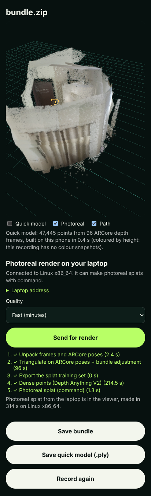

# Phone studio: quick model on the phone, photoreal render on the laptop

The `/record/` page is now the whole capture-to-3D loop, no app install:

1. **Record** on the phone (Android Chrome, WebXR + ARCore): video, AR pose of every frame, ARCore depth,
   a small colour snapshot next to each depth frame, and IMU. Or **open a saved recording** (.zip bundle).
2. **Quick model, on the phone, in about a second:** ARCore depth back-projected with the ARCore pose and
   fused into a 3 cm voxel grid (`quick-model.js`), shown in a 3D viewer with the walked camera path and
   the floor grid. Saved as a .ply with one tap.
3. **Send for render:** the bundle goes to the laptop in 8 MB resumable chunks (`remote.js`). The laptop
   runs one job (`app/pipeline/stages/phone.py`, `POST /api/v1/remote/uploads/...`):
   unpack, triangulate on the ARCore poses + bundle adjustment, dense Depth Anything V2 points aligned to
   those poses, then a Gaussian splat initialised from the dense points (gsplat on an NVIDIA GPU / Colab,
   OpenSplat on a Mac, or any `GAUSSIAN_TRAINER_COMMAND`).
4. **Result back on the phone:** the splat (`.splat`, rendered with Spark) or, without a trainer, the dense
   points, in the same ARCore world frame as the quick model. The phone remembers the render, so
   "Show my last render" works after a reload.

## Run it

On the laptop (Mac: `brew install cloudflared` once):

```bash
python scripts/serve_render.py
```

It starts the server with a fresh pairing key, opens a free Cloudflare quick tunnel, and prints a link
(and a QR code if `pip install qrcode`) to the hosted recorder with `?server=...&key=...`. Open it on the
phone once; the pairing is remembered. The tunnel matters on networks that block phone-to-laptop traffic
(campus Wi-Fi) and gives WebXR the HTTPS it needs. `--no-tunnel` uses the local network instead.

For the photoreal splat without an NVIDIA laptop, open `notebooks/phone_render_colab.ipynb` in Colab
(T4 GPU) and run all cells: it runs the same server with gsplat and prints the phone link.

Quality presets (phone menu): fast = every 15th frame, 2,000 splat steps, half resolution; balanced =
every 10th frame, 7,000 steps; best = every 5th frame, 15,000 steps, full resolution.

### Best on OpenSplat: the sharper recipe

With OpenSplat as the trainer, Best runs `scripts/train_opensplat_best.py` (3,000 steps) instead of
plain training. It is the recipe the whole-room work measured on ICL-NUIM (OpenSplat on CPU, 3,000
steps): held-out PSNR 31.33 -> 32.26 dB, SSIM 0.877 -> 0.900, 344k Gaussians, about 92 min.

1. MODP pixel placement from the dense step's metric depth (saved as
   `geometry/monocular-depth-metric/*.npy`): corners and strong edges every 2 px plus an 8 px grid,
   deduplicated in a MOHV hash voxel. Capped at 500k points at random (`--max-points`); the cap is
   ours, not part of the measured recipe.
2. 3DGS paper densification (`OPENSPLAT_PAPER_ADC=1 --refine-every 100 --densify-from 500
   --densify-until 2500`).
3. MODP error compensation at step 1,000: renders every training view (30 at a time), adds a Gaussian
   at every 8th pixel whose SSIM is below 0.5, then resumes to 3,000.

Steps 2 and 3 need OpenSplat built with the NAMMA patches (`model_paper_adc.diff` and the held-out
patch that adds `--densify-from/--densify-until/--resume/--val-render/--save-every`). A stock OpenSplat
gets step 1 only and says so in `train_info.json` (`patched_opensplat: false`). The pipeline was run end
to end here with a stand-in OpenSplat CLI (39 views: 1,016,802 placed points capped to 500k, 25,236
compensation Gaussians); it has not been measured on phone footage or with the real patched binary.

## Security

The tunnel URL is public, so every `/api/v1/remote` call needs the pairing key (`NAMMA_REMOTE_KEY`, sent
as `X-Namma-Key` or `?key=`). CORS is open because the page is served from GitHub Pages.

## Measured (in this container, 4-core CPU, no GPU)

- Quick model on the real phone bundle (`ar-2026-10-17T11-28-46`, 96 ARCore depth frames at 160x90):
  47,445 points in 0.24 s (Node) / 0.4 s (headless Chromium). Against 10,318 points triangulated
  from the same AR poses: median distance 2.3 cm, 79% within 5 cm, 91% within 10 cm. The flipped-row
  convention gives 27.6 cm, which is how the depth orientation was confirmed.
- Send for render of that bundle, quality fast: 39 frames, ARCore-pose triangulation 1.685 -> 0.585 px
  after BA, dense points 2.9-3.0% alignment error; 167-314 s end to end on this CPU (dense points
  dominate, 0.4-3.4 s per frame depending on load). The splat step used a stand-in trainer
  (`tests/fixtures/fake_splat_trainer.py`, no optimisation) to prove conversion to `.splat` and loading
  185,277 splats into Spark on the phone page.



## Tests

- `node --test tests/browser/quick_model.test.mjs`: back-projection, colour row order, fusion.
- `pytest tests/test_phone_render.py`: chunked upload, missing chunks, idempotent finish, pairing key,
  `.splat` conversion, render plan.
- `node tests/browser/studio_e2e.mjs <server> <key> [bundle.zip] [shot.png]`: headless Chromium with a
  scripted WebXR + depth session (wall 2 m away, red above eye height, blue below), then a real
  bundle sent for render against a running server.

## Not tested yet

- On a real phone: the colour snapshots (the first real bundle predates them, so it is coloured by
  height), Spark's frame rate on a phone GPU, a real tunnel (the container cannot reach
  trycloudflare.com; the tunnel parsing was checked against cloudflared's output format).
- `scripts/train_gsplat.py` on CUDA (adapted from the GPU handout trainer that ran on a T4; its dataset
  loading was checked here on the rendered bundle: 39 views, 5 held out) and the Colab notebook.
- No held-out PSNR for a real splat from a phone bundle yet: the phone shows it once a real trainer runs.
